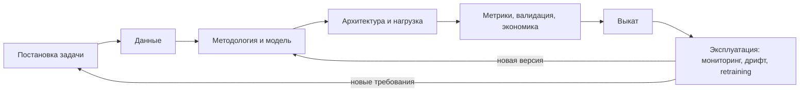

# Занятие 1. Введение: ML-система и design doc

**Модуль:** 1. Постановка задачи, данные и модель  
**Раздел design doc:** знакомство со структурой документа  
**Домашнее задание:** нет. После занятия студент выбирает тему сквозного проекта.

## Смысл занятия

Понять, почему ML-система шире модели и как design doc помогает принимать проектные решения до начала разработки.

## Цели занятия

познакомиться с курсом, с командой и друг с другом;
различать жизненный цикл ML-модели и жизненный цикл ML-системы;
использовать шаблон design doc как рабочий инструмент проектирования;

## Краткое содержание

знакомство с курсом, с командой и друг с другом;
ML-модель, ML-сервис и ML-система: границы понятий;
жизненный цикл ML System Design;
структура `design-doc-template.md` и связи между разделами;
критерии выбора темы сквозного проекта;

## Результат

Конспект занятия.

## Навык по занятию

**Знания:** различия между ML-моделью, ML-сервисом и ML-системой; этапы жизненного цикла ML-системы; назначение разделов `design-doc-template.md` и связи между ними.

**Умения:** оценивать пригодность темы как сквозного проекта курса.

**Навыки:** навигация по шаблону design doc — находить раздел, отвечающий за конкретное проектное решение.

## Домашнее задание

нет.

## Критерий готовности

проверяемый признак: тема пригодна как сквозной проект; студент ориентируется в шаблоне.

## Тайминг (90 мин)

- вход: 40 мин — знакомство с курсом;
- теория: 20 мин — теоретические основы ML-систем;
- практика: 25 мин — разбор шаблона design doc;
- итоги: 5 мин — критерии выбора темы;

## Теория

20 минут, 8 слайдов (~2,5 мин на слайд). Две темы: границы понятий «модель / сервис / система» (слайды 1–3) и жизненный цикл ML System Design (слайды 4–8). Сквозной иллюстративный пример — рекомендации товаров в интернет-магазине (только для иллюстрации; учебный кейс на занятии 1 не вводится).

### Слайд 1. ML-модель, ML-сервис, ML-система: три уровня

**Тезис:** это три разных объекта проектирования с разными владельцами, метриками и причинами отказа.

- **ML-модель** — артефакт: веса + код инференса + контракт на вход/выход. Отвечает на вопрос «насколько точно». Проверяется офлайн-метрикой на отложенной выборке.
- **ML-сервис** — модель, обёрнутая в runtime: API, препроцессинг, ресурсы, SLA. Отвечает на вопрос «как получить предсказание и за сколько». Проверяется latency p95/p99, доступностью, error rate.
- **ML-система** — сервис + всё, что делает его полезным и живым: источники данных, пайплайн обучения, реестр версий, мониторинг, переобучение, fallback, люди и процессы. Отвечает на вопрос «какой эффект и какой ценой». Проверяется бизнес-метрикой при ограничениях по стоимости, надёжности и свежести.

**Пример:** модель — CatBoost с NDCG@10 = 0,42; сервис — `POST /recommend` с p95 ≤ 100 мс при 500 RPS; система — рост выручки с карточки товара на +2 % при cost per 1k requests ≤ 0,05 $ и переобучении раз в сутки.

### Слайд 2. Границы понятий: что меняется при переходе уровня

| | Модель | Сервис | Система |
|---|---|---|---|
| Что проектируем | признаки, алгоритм, порог | API, ресурсы, латентность | потоки данных, обучение, выкат, мониторинг, экономика |
| Критерий успеха | офлайн-метрика | SLA: p95, доступность, ошибки | бизнес-эффект при ограничениях |
| Что ломается | переобучение, утечки | таймауты, OOM, деградация под пиком | дрифт данных, feedback loop, стоимость, молчаливая деградация |
| Владелец | DS | ML/Backend-инженер | кросс-функциональная команда + заказчик |
| Горизонт | до релиза | до следующего деплоя | годы, пока система приносит эффект |

**Что сказать:** одна и та же модель может быть хорошей и плохой системой — зависит от того, что вокруг. Курс проектирует правый столбец; левые два — его части.

**Вопрос в зал:** «У вас упал CTR рекомендаций на 15 % за неделю, модель не менялась. На каком уровне искать причину?» (ожидаемо: система — данные, дрифт, upstream-источник).

### Слайд 3. Модель — малая часть системы

**Тезис:** стоимость, риски и сложность ML-проекта в основном лежат вне кода модели (Sculley et al., *Hidden Technical Debt in ML Systems*, 2015).

- схема из статьи: маленький блок «ML code» в окружении сбора данных, проверки данных, извлечения признаков, конфигурации, serving-инфраструктуры, мониторинга, управления ресурсами;
- ML-специфичный долг: зависимости от данных (а не от кода), entanglement («изменил один признак — изменилось всё»), feedback loops, недекларированные потребители предсказаний;
- вывод для курса: каждая «коробка» вокруг модели — отдельное проектное решение, которое нужно принять и записать до разработки.

**Что сказать:** типовая оценка индустрии — на модель приходится 5–10 % трудозатрат production-проекта. Если проектировать только модель, остальные 90 % придут как сюрприз.

### Слайд 4. Жизненный цикл ML-модели

**Тезис:** цикл модели линейный и конечный — он заканчивается, когда достигнута метрика.

```
данные → признаки → обучение → валидация → артефакт модели
```

- вход: фиксированный датасет; выход: файл модели с офлайн-метрикой;
- критерий завершения: метрика на holdout ≥ порога;
- типичная среда: ноутбук, эксперимент-трекер;
- что не учитывается: как данные попадут в прод, что будет при изменении распределения, сколько стоит инференс, кто и как откатит версию.

**Что сказать:** это цикл эксперимента. Ошибка — считать его циклом проекта. Модель, достигшая метрики, — не результат, а входное условие для системы.

### Слайд 5. Жизненный цикл ML-системы: этапы и решения

**Тезис:** цикл системы начинается до данных и не заканчивается после деплоя.



На каждом этапе — решение и артефакт:

| Этап | Ключевое решение | Артефакт |
|---|---|---|
| Постановка | зачем ML и что считаем успехом | бизнес-цель, сценарии, scope v1 |
| Данные | откуда данные и доступны ли они на инференсе | таблица источников, объёмов, рисков |
| Методология | baseline, схема валидации, семейство моделей | этапы с критериями перехода |
| Архитектура | batch / real-time, инфраструктура, NFR | диаграмма, расчёт нагрузки |
| Валидация и экономика | цепочка метрик, A/B, kill criteria, стоимость | план эксперимента, ROI |
| Эксплуатация | что мониторим, когда переобучаем, как откатываем | алерты, fallback, процедура замены версии |

### Слайд 6. Модель vs система: сравнение циклов

| Признак | Цикл модели | Цикл системы |
|---|---|---|
| Форма | линейный, завершается релизом | замкнутый, повторяется годами |
| Данные | фиксированы | меняются: дрифт, новые источники, feedback loop |
| Критерий «готово» | метрика достигнута | бизнес-эффект достигнут при соблюдении NFR и бюджета |
| Проверка | holdout | holdout → shadow/A/B → мониторинг в проде |
| Цена ошибки | неудачный эксперимент | инцидент: деньги, SLA, доверие пользователей |
| Ответственность | один человек | команда + заказчик + смежные системы |
| Что документируем | ноутбук, отчёт об эксперименте | design doc с решениями, альтернативами и допущениями |

**Что сказать:** различие не в объёме работы, а в типе вопросов. Цикл модели спрашивает «что лучше по метрике», цикл системы — «что приемлемо по совокупности ограничений».

### Слайд 7. Решения принимаются до кода: trade-off'ы по этапам

**Тезис:** в ML System Design нет «правильного» ответа — есть компромисс, зафиксированный с обоснованием.

- **точность vs latency:** тяжёлая модель даёт +3 п.п. метрики, но p95 растёт со 100 до 400 мс — приемлемо ли для сценария;
- **свежесть vs стоимость:** переобучение каждый час или раз в сутки — что даёт дрифт, что стоит GPU-часы;
- **batch vs real-time:** предрасчёт ночью дёшев и прост, но не видит текущую сессию пользователя;
- **автоматизация vs контроль:** автодеплой по метрике или ручная валидация — скорость против риска молчаливой деградации;
- **покрытие vs качество:** fallback на «популярное» для cold-start пользователей — хуже персонализации, но лучше пустого ответа.

**Что сказать:** каждый такой выбор дешевле всего сделать на бумаге. Переписать абзац в документе — минуты; переделать serving под другой режим — недели.

### Слайд 8. Design doc как карта жизненного цикла

**Тезис:** `design-doc-template.md` — это жизненный цикл системы, разложенный по разделам; документ пишется до разработки и живёт вместе с системой.

| Этап цикла | Разделы шаблона | Занятия |
|---|---|---|
| Постановка | 1 | 2 |
| Данные | 2 | 3 |
| Методология и модель | 3 | 4 |
| Архитектура и нагрузка | 4 | 5–6 |
| Валидация и экономика | 5, 6 | 7–8 |
| Эксплуатация и риски | 7, 8 | 9–10 |
| Обоснование и развитие | 9, 10, 11, 12 | 11–12 |
| Summary | 0 — пишется последним | модуль 4 |

Связи, которые делают документ системой, а не набором глав: объёмы данных (2.3) → расчёт нагрузки (4.3) → стоимость (6.1); ограничения scope (1.6) → развитие системы (10.2); RTO (4.3) → план отката (7.6); baseline (3.1) → результаты экспериментов (11.1); единственное место для цепочки метрик — 5.1.

**Что сказать:** правило курса — «решение, не записанное в документе, не принято». Дальше переходим к шаблону и смотрим, где именно записывается каждое решение.

## Учебный кейс

нет

## Практика

25 минут, индивидуально, с открытым `templates/design-doc-template.md`. Два упражнения: навигация по шаблону и заготовка темы проекта. Недописанное дорабатывается в заявке на тему к занятию 2.

### Шаг 1. Структура шаблона и связи между разделами (5 мин, ведёт преподаватель)

- открыть оглавление: разделы 0–12, обязательные и `[опционально]`;
- показать три типа содержимого: курсивные подсказки (что писать), таблицы (что заполнить), чекбоксы в разделе 12 (критерии готовности);
- показать 4–5 связей между разделами со слайда 8 прямо в тексте шаблона: 2.3 → 4.3 → 6.1; 1.6 → 10.2; 4.3 → 7.6; 3.1 → 11.1; 5.1 как единственное место цепочки метрик;
- показать, что раздел 0 Overview пишется последним, раздел 9 наполняется с занятия 3 и сводится на занятии 11.

### Шаг 2. Упражнение «найди раздел» (10 мин, индивидуально + разбор)

Студент получает список проектных решений и для каждого записывает номер подраздела, где оно фиксируется. 6 минут самостоятельно, 4 минуты разбор.

| № | Проектное решение | Ответ |
|---|---|---|
| 1 | «При таймауте сервиса показываем популярные товары» | 1.5 (поведение при сбое), детализация — 7.6 |
| 2 | «p95 ответа ≤ 100 мс при пике 500 RPS» | 4.3 |
| 3 | «Пропуск мошеннической транзакции в 10 раз дороже ложного срабатывания» | 5.2 |
| 4 | «Переобучаем раз в неделю; внепланово — при падении метрики на 5 %» | 7.3 |
| 5 | «История событий за 3 года, прирост 2 ГБ/сутки, храним 18 месяцев» | 2.3 |
| 6 | «Персонализацию для новых пользователей в v1 не делаем» | 1.6; поведение при cold start — 2.5 |
| 7 | «Рассматривали двухбашенную нейросеть, остановились на бустинге» | 3.3 (выбор), 9 (отвергнутая альтернатива) |
| 8 | «Сворачиваем проект, если A/B не покажет +1 % конверсии за 4 недели» | 5.4 |
| 9 | «Оператор может вручную отменить решение модели» | 8.3 |
| 10 | «Стоимость инференса не выше 0,05 $ на 1000 запросов» | 6.1 |

На разборе отметить решения, которые живут в двух разделах (1, 6, 7): это нормально, если разделы ссылаются друг на друга, и ошибка, если дублируют текст.

### Шаг 3. Заготовка темы проекта (10 мин, индивидуально)

Студент заполняет мини-шаблон заявки на тему (структура — из `program/final-project-overview.md`, «Как утверждается тема»). Если данных нет — пишет явные допущения с пометкой «оценка».

```markdown
## Заявка на тему

- Домен и проблема (кто страдает, что будет, если ничего не делать):
- Что предсказываем и на каком объекте:
- Источники данных (что есть / чем правдоподобно заменить):
- Режим работы (batch / real-time / streaming) и порядок нагрузки (запросов в сутки):
- Ожидаемый бизнес-эффект в измеримых величинах:
```

Самопроверка по пяти критериям пригодности (см. «Итоги»): напротив каждого — «да» / «нет» / «не знаю». Любое «нет» — повод сузить или заменить тему до занятия 2; «не знаю» — вопрос преподавателю.

**Шаблон практики для раздачи:** таблица упражнения без столбца «Ответ» + мини-шаблон заявки + чеклист из пяти критериев.

### Итоги (5 мин): критерии выбора темы

Тема пригодна, если одновременно:

- есть бизнес-заказчик и измеримый эффект (деньги, время, конверсия, доля ручной работы);
- обоснованно требует ML — правила и эвристики решают задачу плохо;
- предполагает поток данных: новые события, дрифт, необходимость переобучения;
- имеет считаемые нефункциональные ограничения: RPS, latency, объёмы, стоимость, доступность;
- допускает системный контур: подготовка данных, обучение, serving, мониторинг — есть что проектировать.

Не подходит: соревнование на Kaggle без продуктового контекста; разовый ad-hoc-анализ; исследовательская задача без потребителя; задача, которую полностью решают детерминированные правила; задача без представления об источниках данных. Своя рабочая тема допускается без NDA-чувствительных данных: числа обезличиваются или заменяются порядком величины.

Что сделать до занятия 2: создать git-репозиторий, скопировать `templates/design-doc-template.md` как рабочий файл, заполнить титул, оставить раздел 0 пустым, отправить заявку на тему.

## Типичные ошибки

- **Слишком широкая тема** («ML для банка», «рекомендации для всего маркетплейса»): невозможно посчитать нагрузку и эффект; нужен один сценарий, один объект предсказания, одна бизнес-метрика.
- **«Модель вместо системы»:** тема сформулирована как «обучить классификатор с F1 > 0,9» — нет заказчика, эффекта, потока данных и эксплуатации; документ выродится в отчёт об эксперименте.
- **Смена темы позже:** четыре ДЗ и итоговый проект заполняют один документ; смена темы на занятии 5 обнуляет разделы 1–3. Сомнения снимаются до занятия 2, а не после ДЗ №1.
- **Kaggle-датасет без продуктового контекста:** статичный датасет без потока событий; невозможно спроектировать мониторинг, дрифт и переобучение (разделы 7–8).
- **Тема, где ML избыточен:** задача полностью решается правилами или готовым сервисом; раздел 1.3 не пройдёт проверку.
- **Путаница уровней в формулировках:** бизнес-цель подменяется метрикой модели («цель — повысить AUC»), SLA сервиса выдаётся за эффект системы.
- **NDA-данные в документе:** реальные числа с работы без обезличивания; заменить порядком величины с пометкой «оценка».

## Материалы

**Слайды (8):** три уровня: модель / сервис / система; границы понятий; модель — малая часть системы; жизненный цикл модели; жизненный цикл системы; сравнение циклов; trade-off'ы по этапам; design doc как карта жизненного цикла.

**Фрагменты шаблона и программы:**
- `templates/design-doc-template.md` — оглавление, разделы 0–12 целиком (для навигации);
- `program/final-project-overview.md` — «Как утверждается тема», «Требования к теме», «Этап 0. Подготовка»;
- `templates/checklist.md` — показать как карту проверок на весь курс.

**Литература (из `artifacts/materials.md`):**
- Sculley et al. — *Hidden Technical Debt in Machine Learning Systems* — к слайду 3;
- Chip Huyen — *Designing Machine Learning Systems*, гл. 1–2 (overview и requirements: reliability, scalability, maintainability, adaptability) — к слайдам 1–2, 5–6;
- Made With ML — *Machine Learning Systems Design*: цепочка Product Design → System Design → Development → Deployment → Iteration — к слайду 5;
- Google Cloud — *MLOps: Continuous delivery and automation pipelines* — уровни зрелости 0/1/2 как язык для описания эксплуатационного контура (слайд 5, этап «Эксплуатация»);
- Google — *Rules of Machine Learning*, правила 1–4 («сначала простая система») — к слайду 7.

**Раздатка практики:** таблица «найди раздел» без ответов, мини-шаблон заявки на тему, чеклист пяти критериев пригодности.
